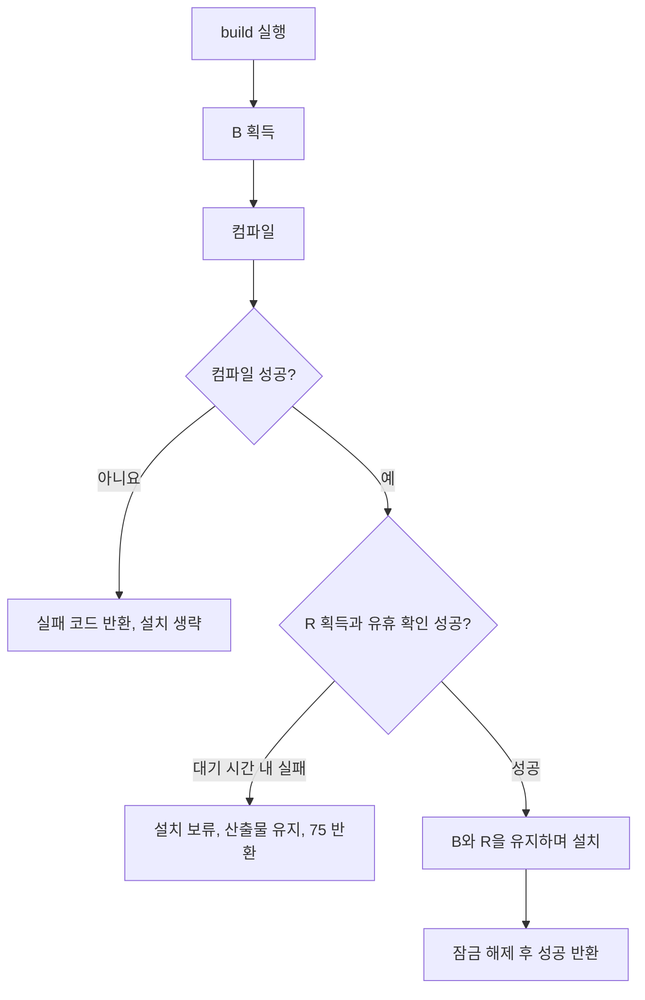

# cubrid-build-coordinator는 무엇이며, 왜 필요한가

`cubrid-build-coordinator`는 Linux에서 **같은 CUBRID 빌드 디렉터리나 설치 디렉터리를 사용하는 명령들의 실행 순서를 조정하는 도구**다. CMake를 실행하기 전에 필요한 잠금을 잡고, 설치 파일을 사용하는 명령이 끝날 때까지 설치 교체를 막는다.

이 도구가 필요한 이유는 컴파일과 설치가 서로 다른 자원을 변경하기 때문이다. 컴파일은 빌드 디렉터리의 산출물을 바꾸고, 설치는 DB 서버·테스트·디버거가 사용할 실행 파일과 라이브러리를 바꾼다. 둘을 구분하면 **DB나 테스트를 계속 실행하면서 컴파일하고, 사용이 끝난 뒤 설치만 수행**할 수 있다.

이 문서는 현재 Python 구현의 동작을 설명한다. 설치 방법과 간단한 사용법은 [README](../README.md), 기존 Bash 구현과의 호환성 검증은 [검증 기록](verification.md)을 참고한다.

## 어떤 문제를 해결하는가

여러 터미널이나 자동화 작업이 같은 개발 환경을 사용할 때 다음 상황이 생긴다.

| 상황 | coordinator를 거치지 않으면 생길 수 있는 일 | coordinator의 처리 |
| --- | --- | --- |
| 두 작업이 같은 빌드 디렉터리에서 configure·compile을 수행 | CMake 설정과 생성 파일, 빌드 산출물의 변경이 겹침 | 빌드 디렉터리별 잠금으로 순서를 정함 |
| 서로 다른 빌드 디렉터리에서 같은 경로로 설치 | 서로 다른 산출물의 설치가 겹침 | 설치 디렉터리별 잠금으로 설치를 직렬화함 |
| DB나 테스트가 쓰는 설치 경로에 새 파일을 설치 | 실행 중인 코드와 이후 읽는 파일의 버전이 달라지거나 설치가 실패할 수 있음 | 설치 잠금과 실행 중인 프로세스를 확인하고, 사용 중이면 설치를 보류함 |
| 설정 편집기·디버거·컨테이너 작업이 설치 경로를 사용 | 실행 파일 검사만으로는 작업 전체의 사용 기간을 알기 어려움 | 명령 또는 전경에서 대기하는 실행 도우미가 끝날 때까지 설치 잠금을 유지함 |
| 설치가 대기 중인데 원인을 모름 | 어떤 터미널이나 작업을 마쳐야 하는지 찾기 어려움 | 잠금 소유자의 PID·명령·작업 디렉터리·터미널을 보고함 |

예를 들어 설정 편집기가 설치 디렉터리 사용 잠금을 잡고 있을 때 `build`를 실행하면, 컴파일은 성공해도 설치 단계에서 종료 코드 `75`를 받을 수 있다. 편집기를 종료한 뒤 `install`을 실행하면 이미 만들어 둔 산출물을 설치한다. 일반 `build`는 편집기나 DB를 종료하지 않는다.

도구를 사용하지 않아도 단독 작업에서 CMake나 CUBRID 명령을 실행할 수는 있다. 다만 위와 같은 동시 작업의 순서와 사용 기간을 호출자가 직접 관리해야 한다. 한쪽만 coordinator를 사용해도 직접 실행한 다른 쪽이 잠금에 참여하지 않으면 보호에 빈틈이 생긴다.

## 다른 도구와 어떻게 나뉘는가

| 구성 요소 | 맡은 일 |
| --- | --- |
| CMake | 설정, 컴파일, 타깃 실행, 설치의 실제 작업 |
| `cubrid-build-coordinator` | 잠금 획득 순서, 설치 가능 여부 확인, 자식 명령의 실행과 종료 대기, 잠금 소유자 진단 |
| `cub-workenv` | 호스트 작업 환경 초기화와 선택, 저장된 환경 설정, DB 등록·생성 |
| `my-cubrid`의 공용 레시피·실행 도우미 | 사용자 명령을 coordinator로 연결하고, JDK 준비나 컨테이너 수명 관리 등 호출별 작업을 수행 |

coordinator는 명령을 실행하는 동안 전경에서 동작한다. 설치를 보류해도 백그라운드 큐에 등록하거나 나중에 자동 설치하지 않는다. CUBRID의 트랜잭션 잠금이나 DB 파일 잠금과도 별개다.

현재 저장소는 기존 `my-cubrid` Bash coordinator를 독립 Python CLI로 옮긴 것이다. 빌드·설치 조정 로직을 하나의 패키지로 설치하고 검증할 수 있으며, 기존 호출자는 `exec` shim을 통해 같은 CLI를 사용할 수 있다. 기존 Bash 호출자와 같은 잠금 규약을 사용하므로 함께 실행해도 같은 자원을 조정한다. shim을 사용하는 환경에는 Python CLI가 설치되어 있어야 하며, shim 자체에는 대체 구현이 없다.

## 두 종류의 잠금

| 잠금 | 식별 기준 | 지키는 자원 |
| --- | --- | --- |
| 빌드 잠금, 이하 **B** | 정규화한 `CUBRID_BUILD_DIR` 경로 | CMake 설정과 빌드 산출물 |
| 설치 사용 잠금, 이하 **R** | 정규화한 `CUBRID` 경로 | 설치 파일을 사용하는 기간과 설치·삭제 작업 |

구현에서 R의 이름은 `runtime`이다. DB만을 위한 잠금은 아니며, 설정 편집기와 테스트도 같은 설치 경로를 사용하면 R을 잡는다. 모든 잠금은 Linux `flock`의 **배타 잠금**이다.

- 같은 빌드 경로를 쓰면 브랜치나 명령 이름이 달라도 B를 공유한다.
- 빌드 경로가 달라도 설치 경로가 같으면 R을 공유한다.
- 같은 설치 경로에서 서로 다른 DB를 선택해도 R을 공유한다. DB 이름은 잠금 식별 기준이 아니다.
- 심볼릭 링크 등으로 표기가 달라도 `realpath -m` 결과가 같으면 같은 자원으로 취급한다.

B와 R이 모두 필요한 action은 **B → R 순서**로 획득한다. `build`는 컴파일 후 R을 기다리는 동안에도 B를 유지한다. 따라서 같은 빌드 디렉터리의 다른 컴파일은 그 대기가 끝날 때까지 기다릴 수 있다.

잠금 파일은 다음 네임스페이스에 둔다. 파일 이름의 해시는 정규화한 자원 경로의 바이트로 계산한다. 기존 Bash와의 호환성을 위해 해시 계산 시 경로 끝의 개행 바이트를 제거한다.

```text
${XDG_RUNTIME_DIR:-/tmp}/cubrid-dev-locks-${UID}/
    build-<SHA-256>.lock
    runtime-<SHA-256>.lock
```

사용자가 다르거나 `XDG_RUNTIME_DIR`가 다르면 같은 설치 경로라도 이 잠금을 공유하지 않는다.

## action 전체 보기

여기서 **유휴 확인**은 설치 경로 아래의 실행 파일을 실행 중인 프로세스가 있는지 `/proc/PID/exe`로 확인하는 절차다. `runtime`과 `installation-use`는 설치를 사용하는 명령이므로 이 검사를 요구하지 않는다. 설치를 교체하거나 삭제하는 action이 유휴 확인을 수행한다.

| Action | 처리 순서 | 호스트 환경 선택 |
| --- | --- | --- |
| `configure` | B → CMake 설정 | 없음 |
| `compile` | B → 컴파일 | 없음 |
| `target TARGET` | B → R → 유휴 확인 → 타깃 실행 | 없음 |
| `build [SECONDS]` | B → 컴파일 → R → 유휴 확인 → 전체 설치 | 없음 |
| `install [SECONDS]` | B → R → 유휴 확인 → 기존 산출물 전체 설치 | 없음 |
| `install-target TARGET [SECONDS]` | B → R → 유휴 확인 → 타깃 실행 | 없음 |
| `runtime [SECONDS] [--database NAME] -- COMMAND...` | R → 환경 선택 → 선택적 DB 등록 확인 → 명령 실행 | `cub-workenv`로 선택 |
| `installation-use [SECONDS] [--database NAME] -- COMMAND...` | R → 선택적 DB 등록 확인 → 명령 실행 | 없음 |
| `installation-delete [SECONDS]` | B → R → 유휴 확인 → 삭제 경로·저장 파일 확인 → 삭제 | 없음 |
| `stop-and-build` | B → 컴파일 → R → 환경 선택 → 명시적 중지 → 유휴 확인 → 전체 설치 | `cub-workenv`로 선택 |
| `locks [--all] [--json]` | 잠금과 소유자 조회 | 없음 |

### `configure`: 빌드 설정을 변경하는 진입점

```sh
cubrid-build-coordinator configure
```

B를 잡고 `cmake --preset "$PRESET_MODE"`를 실행한다. 빌드 설정을 생성·갱신하는 단계이며 컴파일과 설치는 수행하지 않는다.

설정 단계도 빌드 디렉터리를 변경하므로 컴파일과 같은 B를 사용한다. 직접 CMake 설정을 실행하면 다른 coordinator 작업과 설정 변경이 겹칠 수 있다. `build`가 configure를 자동 실행하지는 않는다. 최초 설정이나 설정 변경이 필요할 때 이 단계를 별도로 수행한다.

### `compile`: 실행 환경을 건드리지 않고 산출물만 생성

```sh
cubrid-build-coordinator compile
```

B를 잡고 `cmake --build --preset "$PRESET_MODE"`를 실행한다. R을 잡지 않으므로 같은 설치 경로를 사용하는 DB·편집기·테스트가 있어도 컴파일할 수 있다. 이 설명은 일반 컴파일 타깃이 빌드 트리만 변경한다는 전제다. 설치할 수 있는 임의 타깃은 아래 `target`으로 실행한다.

이 action은 컴파일 결과만 확인하거나 설치를 나중으로 미룰 때 필요하다. 직접 컴파일하면 같은 빌드 디렉터리의 다른 설정·컴파일·설치와 순서를 조정하지 못한다. 또한 `compile` 성공만으로 설치 경로의 CUBRID가 새 버전으로 바뀌지는 않는다.

### `target TARGET`: 임의 타깃을 보수적으로 보호

```sh
cubrid-build-coordinator target util/install
```

B와 R을 잡고 유휴 확인 후 다음 명령을 실행한다.

```sh
cmake --build --preset "$PRESET_MODE" --target util/install
```

임의 타깃은 컴파일만 할 수도 있고 설치 파일을 바꿀 수도 있다. coordinator는 타깃 이름으로 그 효과를 판별하지 않고 모두 설치에 준하는 보호를 적용한다. 그래서 컴파일 전용 타깃이어도 설치 경로가 사용 중이면 거절될 수 있다.

직접 `cmake --build ... --target ...`을 실행하면 이 보호를 우회한다. 설치 타깃이었을 경우 실행 중인 환경을 변경할 수 있다. 현재 `target`의 R 대기는 0초이며, CLI에서 별도의 대기 시간을 받지 않는다.

### `build`: 컴파일 후 사용 가능한 시점에 설치

```sh
cubrid-build-coordinator build
cubrid-build-coordinator build 300
```

B를 잡고 컴파일한다. 성공하면 B를 유지한 채 R 획득과 유휴 확인을 시도하고, 통과하면 전체 설치한다. 컴파일 실패 시 설치하지 않는다. 설치 대기 시간의 기본값은 0초다.



이 action은 컴파일과 설치 사이에 다른 작업이 같은 빌드 산출물을 바꾸지 못하게 한다. 직접 컴파일 후 설치하거나 `compile`과 `install`을 별도 호출하면 두 단계 사이에 B가 해제되어 다른 작업이 끼어들 수 있다.

일반 `build`는 프로세스를 중지하지 않는다. 설치가 보류되면 사용 중인 작업을 마친 뒤 `install`로 재시도한다. `build 300`은 컴파일 후 최대 300초 동안 설치 가능 여부를 기다리며, 자동 재시도를 예약하는 명령은 아니다.

### `install`: 다시 컴파일하지 않고 설치만 재시도

```sh
cubrid-build-coordinator install
cubrid-build-coordinator install 300
```

B와 R을 잡고 유휴 확인 후 다음 명령으로 기존 산출물을 설치한다.

```sh
cmake --install "$CUBRID_BUILD_DIR" --prefix "$CUBRID"
```

컴파일이 끝났는데 설치만 보류된 경우 필요한 action이다. 이 단계에서 다시 `build`할 필요는 없다. 다만 `install`은 소스 변경을 컴파일하지 않으므로, 설치할 산출물이 최신인지 호출자가 판단해야 한다.

전체 설치 전에는 빌드의 `vm/jdk8`이 디렉터리인지 심볼릭 링크인지에 맞춰 설치 대상의 기존 형태를 조정한다. 직접 `cmake --install`을 실행하면 잠금·유휴 확인과 이 JDK 전환 처리를 건너뛴다. 설치는 원자적 교체가 아니며, 중간 실패 시 일부 파일이 이미 바뀌었을 수 있다.

### `install-target TARGET`: 부분 설치에도 같은 보호 적용

```sh
cubrid-build-coordinator install-target 3rdparty/install 300
cubrid-build-coordinator install-target util/install 0
```

B와 R을 잡고 유휴 확인 후 지정한 CMake 타깃을 실행한다. 일부 구성 요소만 설치하는 호출자가 전체 `install` 대신 사용할 수 있다. 부분 설치도 사용 중인 설치 파일을 바꿀 수 있으므로 같은 보호가 필요하다.

현재 실제 타깃 실행과 보호 방식은 `target`과 같다. 별도 action이 있는 이유는 부분 설치라는 호출 의도를 드러내고, 선택적인 설치 대기 시간을 받을 수 있게 하기 위해서다. 기본 대기는 0초다. `install-target` 자체가 전체 `install()` 처리를 호출하지는 않으므로, 앞의 JDK 전환 처리도 수행하지 않는다.

`target`과 `install-target`은 타깃 호출에 `--prefix "$CUBRID"`를 덧붙이지 않는다. 타깃이 실제로 변경하는 설치 위치도 R이 보호하는 `CUBRID` 경로와 일치하도록 구성해야 한다.

이 action을 거치지 않고 부분 설치하면 전체 설치와 마찬가지로 빌드·설치 충돌과 실행 중인 환경 변경을 막지 못한다.

### `runtime`: 선택한 호스트 환경에서 명령 실행

```sh
cubrid-build-coordinator runtime 300 --database example -- csql -S -u dba example
```

R을 잡은 뒤 `cub-workenv env`로 현재 작업 디렉터리·프리셋·설치 경로에 해당하는 환경을 선택한다. 반환된 환경이 준비 상태이고, 그 설치 경로가 잠근 경로와 같은지 확인한 다음 명령을 실행한다. 선택에 실패하면 명령을 실행하지 않는다.

호스트 DB 명령, 디버거, 설정 편집기처럼 선택된 환경을 사용해야 하는 작업을 위한 진입점이다. `--database NAME`을 주면 선택된 `$CUBRID_DATABASES/databases.txt`에 이름이 등록되어 있는지도 확인한다. 이는 등록 확인이며 DB 생성·기동이나 DB별 잠금이 아니다.

직접 `csql` 등을 실행하는 방식도 지원되지만, 그 경우 coordinator가 실행 직전에 환경을 선택·확인하지 않으며 명령 수명 동안 R을 유지하지 않는다. 기존 셸에 남은 다른 환경을 사용할 수 있고, 다른 설치 작업과의 조정도 빠진다. 설치 시의 프로세스 검사는 일부 직접 실행을 발견할 수 있지만 이 예약을 완전히 대신하지는 못한다.

이 action은 미초기화 환경을 자동으로 초기화하지 않는다. 호스트 DB 작업에 필요한 초기화·DB 생성은 `cub-workenv`에서 명시적으로 수행한다.

### `installation-use`: 호스트 DB 초기화 없이 설치 사용 기간 보호

```sh
cubrid-build-coordinator installation-use 300 -- ctest --test-dir "$CUBRID_BUILD_DIR" --output-on-failure
```

R을 잡고 전달받은 환경으로 명령을 실행한다. `runtime`과 달리 `cub-workenv` 환경 선택이나 호스트 준비 상태 확인을 하지 않는다. ctest나 설치 경로를 마운트하는 컨테이너 실행 도우미처럼 호스트 DB 초기화와 독립적인 작업에 사용한다. `--database`를 주면 전달받은 환경에서 DB 등록을 확인한다.

이 구분이 없고 모든 작업에 `runtime`을 요구하면 DB가 필요 없는 테스트도 호스트 DB 초기화를 요구받는다. 반대로 직접 명령을 실행하면 테스트·컨테이너가 설치 파일을 쓰는 동안 R이 유지되지 않는다.

컨테이너의 경우 실행 도우미가 컨테이너 사용·정리가 끝날 때까지 전경에서 살아 있어야 한다. 컨테이너를 생성한 뒤 즉시 종료하는 명령만 감싸면 이후 컨테이너 수명까지 보호하지 못한다. 컨테이너 식별과 삭제 책임은 해당 도우미에 있다.

이 action이 잡는 잠금은 R뿐이다. 예를 들어 ctest가 읽는 **빌드 트리 자체의 동시 변경까지 막아 주지는 않는다.**

### `installation-delete`: 사용 중인 설치와 위험한 삭제 경로 보호

```sh
cubrid-build-coordinator installation-delete 300
```

B와 R, 유휴 확인을 통과한 뒤 삭제 대상 경로를 검사한다. 대상이 현재 작업 디렉터리·홈·빌드 디렉터리 자신이거나 이들을 포함하는 상위 경로이면 거절한다. 심볼릭 링크 등을 정규화한 경로도 확인한다. 설치 트리에 일반 파일 형태의 `*_vinf`나 `*_lgat`가 있어도 DB 저장 파일이 있다고 판단하여 삭제를 거절한다.

검사를 통과하면 정규화한 설치 경로를 `/bin/rm -rf --`로 삭제한다. CLI 자체에는 추가 확인 질문이 없다. 이 action은 설치 파일 삭제이며, `cub-workenv` 상태나 외부 DB 저장소의 정리 절차를 수행하지 않는다. 파일 검사는 디렉터리 심볼릭 링크를 따라가지 않으므로 모든 DB 저장 위치를 조사했다는 뜻도 아니다.

직접 `rm -rf`를 실행하면 사용 중인 설치 확인, 빌드 작업과의 조정, 넓은 삭제 경로 및 DB 저장 파일 방어를 모두 건너뛴다.

### `stop-and-build`: 중지를 명시적으로 요청한 경우의 재설치

```sh
cubrid-build-coordinator stop-and-build
```

일반 `build`와 달리 실행 환경을 중지하고 설치하는 action이다. 순서는 다음과 같다.

1. B를 잡고 먼저 컴파일한다. 컴파일 실패 시 중지 단계로 가지 않는다.
2. R을 잡고 `cub-workenv`로 호스트 환경을 선택·확인한다.
3. 선택된 설치의 `cubrid server status`에 나타난 `Server`·`HA-Server`의 DB 등록을 확인하고 서버를 중지한다.
4. `service stop`, `broker stop`을 시도한다.
5. 설치 경로의 실행 파일을 사용하는 프로세스가 사라질 때까지 최대 30초 기다린다.
6. 유휴 상태가 되면 전체 설치한다. 자동으로 서버를 재시작하지 않는다.

30초가 지나도 프로세스가 남으면 종료 코드 `1`을 반환하고 설치하지 않는다. 강제 종료로 전환하지 않는다. `service stop`·`broker stop`의 실패 자체는 무시하고 이후 프로세스 확인으로 설치 가능 여부를 판단한다.

이 action은 중지와 재설치를 하나의 잠금 구간으로 조정하고, 컴파일 실패 때문에 불필요하게 서버를 먼저 내리는 일을 피한다. 직접 중지 후 빌드하면 그 순서와 잠금을 호출자가 관리해야 한다. 일반 `build`만 사용하면 실행 중인 환경을 보존하며 설치를 보류하므로, 명시적인 중지 동작은 일어나지 않는다.

이 CLI action 자체에는 확인 질문이 없다. 중지를 원할 때만 선택한다. 중지 도중이나 설치 단계에서 실패하면 이미 중지한 일부 프로세스는 그대로 중지 상태일 수 있다.

### `locks`: 무엇이 기다리게 하는지 확인

```sh
cubrid-build-coordinator locks
cubrid-build-coordinator locks --all
cubrid-build-coordinator locks --json
```

기본 호출은 선택된 빌드·설치 경로의 잠금을 조회한다. `--all`은 현재 사용자와 `XDG_RUNTIME_DIR` 네임스페이스의 유휴 상태가 아닌 잠금을 조회하며, 선택된 환경 없이도 실행할 수 있다. `--json`은 스키마 버전이 있는 JSON을 출력한다. `--all --json`도 함께 사용할 수 있다.

조회는 잠금을 획득하거나 잠금 파일을 생성하지 않는다. Linux 커널의 잠금 정보와 살아 있는 파일 디스크립터를 대조해 소유자를 찾는다. 읽을 수 있는 정보에 한해 PID·사용자·명령·작업 디렉터리·터미널 등을 표시한다. 프로세스 나이는 잠금을 보유한 시간이 아니다.

설치가 보류되었을 때 어떤 편집기·테스트·실행 도우미가 사용 중인지 확인하기 위한 action이다. 사용하지 않아도 나머지 잠금은 동작하지만, 대기 원인을 찾으려면 직접 `/proc` 등을 조사해야 한다. 조회 결과는 순간의 상태이며 이후 사용을 예약하지 않는다. 결과가 `unknown`이면 유휴 상태로 간주하지 말고 조회를 재시도하거나 가시성을 확인한다.

잠금 파일은 해제 후에도 남는다. 파일이 존재한다는 사실만으로 사용 중이라고 판단하지 않는다. **파일을 지워서 잠금을 풀려고 하면 안 된다.** 기존 소유자와 새 호출자가 서로 다른 inode를 잠가 동기화가 깨질 수 있다.

## 실행 전에 필요한 값과 대기 시간

도구 자체에는 Python 3.10 이상, Linux `/proc`, GNU `realpath`, CMake가 필요하다. 호스트 환경을 선택하는 action은 Bash와 `cub-workenv`도 필요하다. `CUB_WORKENV_CLI`로 선택기 실행 경로를 지정할 수 있다.

`locks`와 도움말 외의 모든 action은 다음 값을 요구한다. CMake를 직접 실행하지 않는 action도 CLI 진입 시 CMake와 `realpath`의 존재를 검사한다.

| 환경 변수 | 의미 |
| --- | --- |
| `PRESET_MODE` | 사용할 CMake 프리셋 |
| `CUBRID_BUILD_DIR` | 해당 프리셋의 빌드 디렉터리 |
| `CUBRID` | 사용할 설치 디렉터리 |

`PRESET_MODE`가 가리키는 실제 빌드 위치와 `CUBRID_BUILD_DIR`는 일치하도록 호출 환경에서 설정해야 한다. coordinator는 이 값들로 실행 대상과 잠금 대상을 정하며, 프리셋 정의를 별도로 분석해 일치 여부를 검증하지 않는다.

`locks` 기본 조회에는 `CUBRID_BUILD_DIR`와 `CUBRID`가 필요하고 `PRESET_MODE`는 필요 없다. `locks --all`에는 이 세 값이 모두 필요 없다.

| 대기 대상 | 기본값 | 변경 방법 |
| --- | --- | --- |
| B 획득 | 600초 | `CUBRID_BUILD_LOCK_TIMEOUT` |
| `build`, `install`, `install-target`의 R·유휴 확인 | 0초 | action의 `SECONDS` 인수 |
| `target`의 R·유휴 확인 | 0초 | 해당 action에는 대기 인수 없음 |
| `runtime`, `installation-use`의 R 획득 | 300초 | `CUBRID_RUNTIME_LOCK_TIMEOUT` 또는 `SECONDS` |
| `installation-delete`의 R·유휴 확인 | 300초 | `CUBRID_RUNTIME_LOCK_TIMEOUT` 또는 `SECONDS` |
| `stop-and-build`의 R 획득 | 300초 | `CUBRID_RUNTIME_LOCK_TIMEOUT` |
| 명시적 중지 후 프로세스 종료 확인 | 30초 | 고정값 |

`CUBRID_RUNTIME_LOCK_TIMEOUT`을 늘려도 일반 설치 action의 기본 대기 0초는 바뀌지 않는다. 대기 시간은 0 이상의 정수 초이며, 잠금 획득이나 유휴 상태 대기에 적용된다. 컴파일 시간이나 실행하는 명령의 전체 수행 시간 제한이 아니다.

`runtime`·`installation-use`에서 `--database`를 사용할 때는 호환되는 파싱을 위해 숫자 대기 시간을 먼저 적는다. 전달 명령 앞에는 `--`를 사용한다. coordinator는 전달 인수를 셸 코드로 해석하지 않는다. 셸 연산이 필요하면 호출자가 명시적으로 셸을 실행해야 한다.

## 종료 코드와 설치 보류 처리

| 코드 | 의미 |
| --- | --- |
| `0` | action 성공 |
| `75` | coordinator의 잠금 획득·유휴 확인 대기 초과로 작업 보류 |
| `64` | action 인수·대기 값·삭제 경로 등 명시적인 사용 오류 |
| `1` | 필수 환경 누락, 명령 시작 실패, 중지 시간 초과 등. 조회 상태가 `unknown`인 경우도 포함 |
| 그 외 | 자식 명령·환경 선택 실패 코드 전달. 시그널 종료는 `128 + 시그널 번호` |

`locks`의 인수 오류는 별도 파서가 처리하므로 `2`를 반환한다. 자식 명령의 상태를 그대로 전달하기 때문에 숫자만으로 원인을 단정하지 말고 진단 메시지도 확인한다.

컴파일 후 설치 보류가 확인된 경우의 흐름은 다음과 같다.

1. `cubrid-build-coordinator locks`로 소유자를 확인한다. 잠금 없이 직접 실행 중인 네이티브 프로세스는 설치 실패 메시지에 나타날 수 있다.
2. 해당 편집기·테스트·DB 작업을 정상적인 절차로 마친다.
3. `cubrid-build-coordinator install`을 다시 실행한다. 기다리면서 설치하려면 `install 300`처럼 지정한다.

이 경우 컴파일 산출물은 남지만 설치는 완료되지 않았다. 반면 CMake 설치 자체가 실패한 경우에는 부분 변경이 남을 수 있으므로, 설치 보류와 같은 상태로 취급하지 않는다.

## 보장 범위와 사용 시 알아야 할 한계

- **협력하는 호출자 사이의 조정이다.** 직접 실행, 다른 사용자, 다른 잠금 네임스페이스의 작업은 R에 자동 참여하지 않는다. 설치 전 네이티브 실행 파일 검사는 이미 보이는 일부 직접 실행을 보완하지만, 검사 직후의 새 실행을 원자적으로 막지는 못한다.
- **네이티브 실행 파일 검사에는 가시성 한계가 있다.** `/proc` 권한·PID 네임스페이스에 따라 프로세스를 읽지 못할 수 있고, 설치 경로의 라이브러리만 매핑한 프로세스는 실행 파일 경로 검사로 식별하지 못한다.
- **R은 공유 읽기 잠금이 아니다.** 같은 설치를 감싼 테스트 두 개도 직렬 실행된다. 같은 R을 잡은 명령 안에서 다시 coordinator로 같은 R을 요청하면 자기 작업을 기다리다가 시간 초과할 수 있다.
- **잠금 수명은 전경 감독 프로세스가 관리한다.** 자식에게 잠금 디스크립터를 상속하지 않으며, 자식 명령이 종료 정리를 마칠 때까지 기다린 뒤 해제한다. `TERM`·`INT`·`HUP`·`QUIT`는 직접 자식에게 전달하며 전체 프로세스 트리를 종료하지는 않는다. 감독 프로세스가 강제 종료되면 정리 순서를 보장할 수 없다.
- **명령이 띄운 데몬의 전체 수명을 자동 추적하지 않는다.** 시작 명령이 끝나면 R은 해제된다. 이후 설치 시 네이티브 프로세스 검사가 보완한다. 컨테이너 등에는 사용이 끝날 때까지 살아 있는 전경 도우미가 필요하다.
- **설치 잠금은 DB 데이터 보호나 설치 롤백을 대신하지 않는다.** 빌드·설치는 DB를 초기화하지 않으며, DB 등록 확인도 저장소의 완전한 검사나 동시 접근 안전성 증명이 아니다. 삭제 방어를 통과했다고 외부 DB 저장소까지 정리된 것은 아니다.

## 구현과 검증을 더 읽으려면

| 확인할 내용 | 저장소 근거 |
| --- | --- |
| action 문법과 종료 코드 | [cli.py](../cubrid_build_coordinator/cli.py) |
| action별 순서, 중지·삭제·JDK 처리 | [coordinator.py](../cubrid_build_coordinator/coordinator.py) |
| 경로 정규화, 잠금 식별과 획득 | [locks.py](../cubrid_build_coordinator/locks.py) |
| 자식 명령 감독과 네이티브 실행 파일 검사 | [processes.py](../cubrid_build_coordinator/processes.py) |
| 호스트 환경 선택과 DB 등록 확인 | [workenv.py](../cubrid_build_coordinator/workenv.py) |
| 잠금 소유자 조회 | [status.py](../cubrid_build_coordinator/status.py) |
| 컴파일 후 설치 보류·재시도, 혼합 호출자, 중지 순서와 삭제 방어 검증 | [test_acceptance.py](../tests/test_acceptance.py) |
| 명령 수명·잠금 해제와 조회 검증 | [test_runtime_legacy.py](../tests/test_runtime_legacy.py), [test_status_legacy.py](../tests/test_status_legacy.py) |

이 저장소의 검증은 임시 설치 디렉터리와 테스트용 명령을 이용한다. 전체 CUBRID 엔진을 컴파일하거나 사용자 DB의 SQL 동작을 검증하는 테스트는 아니다. 구체적인 실행 범위와 결과는 [검증 기록](verification.md)에 정리되어 있다.
